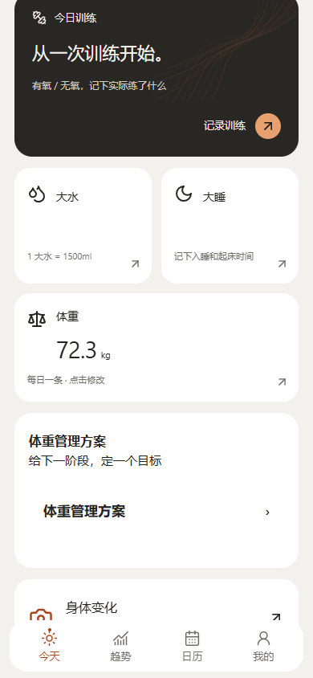
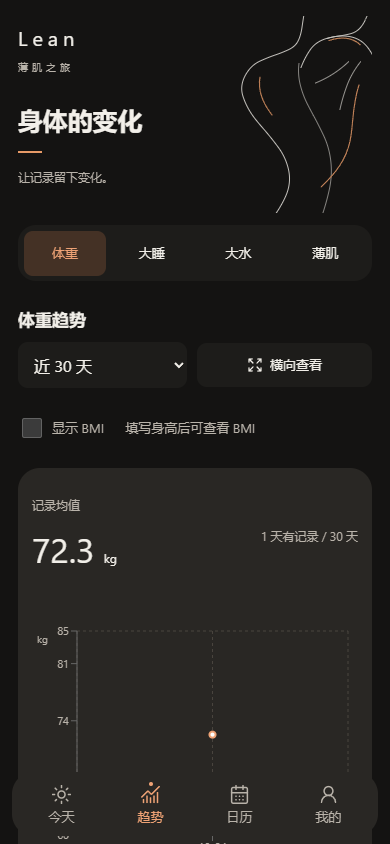
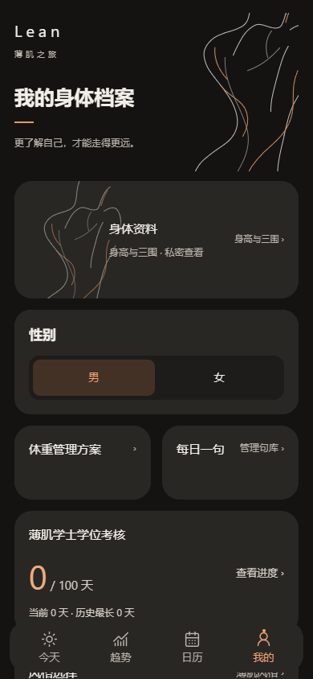

# Lean Starter · 薄肌 LEAN 个人非商业开发模板

基于 **薄肌 LEAN 1.6.6**。把源码复制到自己的账号，交给 Codex 或其他 vibe coding 工具修改，再部署成自己的独立网站。

**允许个人非商业学习、修改、自部署和安装使用；未经另行书面授权，不允许商用。** 改名、改配色或重新打包不会解除原项目内容的许可限制。请先阅读 [LICENSE](LICENSE) 和 [来源声明](NOTICE)。这不是 MIT/Apache/GPL 标准开源项目。

> 你的副本、你的账号、你的网站、你的本机记录。源码不提供原站的发布权限，也不连接原站用户数据。

## 界面预览

下面均为隔离浏览器中的演示数据，不含真实用户记录。

| 薄肌风格首页 | 深色趋势 | 身体档案 |
| --- | --- | --- |
|  |  |  |

## 保留的能力

- 水、睡眠、训练、体重与目标记录；日历补记、趋势及 BMI。
- 默认风格 / 薄肌风格，独立的浅色 / 深色 / 跟随系统。
- 身高与可选三围、照片记录与比较、每日一句管理和文本导入。
- 本机数据、完整备份恢复、恢复副本、文件夹备份能力及 PWA 离线安装；具体能力依浏览器而异。
- 连续训练娱乐学位与分享卡：四种模板、最多30个可见字符的自定义短句、真实 PNG 预览下载和本地二维码。

公开版附带60条中英文**示例短句**，不包含正式版的文学引文集合。句库编辑、导入、删除及备份功能均保留。

## 1. 复制到自己的账号

若顶部有 **Use this template**，选择它创建自己的仓库；也可以 Fork、下载 ZIP 或克隆后建立自己的仓库。

- 模板仓库帮助你开始独立项目；Fork 适合保留与上游的关联并提交改进。
- 不要申请或复用维护者正式站的部署凭据。
- 你的仓库更新不会自动更新原站；本仓库 CI 只检查源码，不发布原站。

## 2. 本机启动

需要 Node.js **24.x** 和 npm。没有安装时先安装 Node.js 24，再打开终端运行：

```sh
npm ci
npm run dev
```

打开终端显示的本机网址。不要双击 index.html，也不要用 file:// 打开构建产物。

构建和检查：

```sh
npm run check
npm test -- --maxWorkers=1
npm run build
npm run preview
```

浏览器测试首次需要安装浏览器：

```sh
npx playwright install chromium
npm run test:smoke
```

完整浏览器回归：`npm run test:e2e`。Windows 如使用已安装 Edge，可先在 PowerShell 执行 `$env:PLAYWRIGHT_CHANNEL='msedge'`。结果位于被 Git 忽略的 `artifacts/`。

## 3. 交给 Codex / 其他 AI

复制下面这段到你自己的代码目录对应的 AI 任务中：

> 阅读 README.md、AGENTS.md 和 docs/CODEX_START.md。先运行检查并了解当前功能，在我自己的仓库中按我的要求修改，保留现有数据、照片、备份和隐私边界。遵守非商业许可和来源说明。部署时只使用我自己的托管账号与新项目，不连接或覆盖薄肌 LEAN 原站。分享链接必须指向我自己的站点。完成后给出测试结果、改动说明和我自己的部署网址。

更具体的改设计、加功能和排错示例见 [AI 开发指南](docs/CODEX_START.md)。本项目无需 AI API key 就能运行；AI 编程工具只用于开发过程。

## 4. 部署自己的网页

推荐先使用 **Cloudflare Pages**，连接你自己的 GitHub 仓库：

| 设置 | 值 |
| --- | --- |
| Node.js | 24（使用仓库 .nvmrc 或设置 NODE_VERSION=24） |
| 构建命令 | npm run build |
| 输出目录 | dist |
| 根目录 | 仓库根目录 |

不需要本项目维护者提供任何密钥。CI 与个人托管账号的自动发布是两套独立配置。

- 不配置网址时，二维码和复制链接自动使用当前打开的站点地址。
- 若有自己的长期正式域名，可按 [.env.example](.env.example) 配置 `VITE_PUBLIC_APP_URL=https://你的域名/`，然后重建；不要填上游地址。
- `VITE_APP_NAME` 控制浏览器标题和安装名称；界面具体文案和图标可让 AI 按 [改品牌指南](docs/CUSTOMIZATION.md) 修改。
- 所有 `VITE_*` 值会出现在前端，不能放访问令牌、密码或其他秘密。

详见 [独立部署教程](docs/DEPLOY.md)。本发行优先支持 HTTPS 根路径部署，不直接承诺 GitHub Pages 的 `/仓库名/` 子路径。

## 数据与隐私

记录存在当前浏览器的 IndexedDB，不会因为复制源码就获得维护者或其他使用者的记录。不同域名、浏览器和设备不自动同步；换域名、卸载或清数据前应导出并核对完整备份。浏览器内恢复副本不能替代外部文件备份。

不要将健康记录、照片、备份、导出文件、令牌或 .env 提交到仓库。共享截图前检查是否有敏感数值。分享默认隐藏昵称和体重，三围与照片不会自动进入分享卡。

## 许可、贡献与安全

- [个人非商业许可](LICENSE)：允许个人自用，不授权销售、付费服务、广告变现、商业引流、收费代部署或商业交付。
- [来源与身份](NOTICE)、[品牌边界](docs/BRAND.md)：保留原有来源，不冒认原创，不冒充官方。
- [第三方说明](THIRD_PARTY_NOTICES.md)：第三方组件继续遵循原许可，不被本项目非商业条款替换。
- [贡献指南](CONTRIBUTING.md)、[安全说明](SECURITY.md)、[公开版变更记录](CHANGELOG.md)。

版权所有 © 2026 shijimobianhua。个人衍生版请标注自己的修改，并保留可访问的来源与许可说明。
